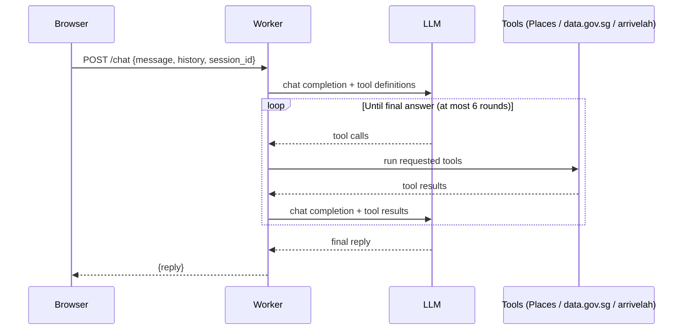

# Lunch Uncle

Lunch Uncle is a chatbot that tells you where to eat lunch near CT Hub 2, Lavender, Singapore. Uncle speaks casual Singaporean English, and he has strong opinions about where you should go.

## Architecture

Lunch Uncle runs as a single Cloudflare Worker. `src/index.js` routes requests: `GET /` serves the chat page from `src/ui.html`, and `POST /chat` hands the turn to the agentic loop in `src/loop.js`. The loop calls an OpenAI-compatible chat completions endpoint, passing the tool definitions from `src/tools.js`. When the model asks for a tool call, the loop runs it, appends the result to the message list, and calls the model again. This repeats until the model gives a final answer with no more tool calls, for at most 6 rounds and 12 tool calls per turn. If the loop runs out, it asks the model for one last answer without tools. `src/prompt.js` holds the system prompt that sets Uncle's persona and rules. It stays the same on every request so the provider can cache it, and the current Singapore time goes into the user message instead. There are three tools: `find_lunch_places`, which queries the Google Places API (New) Text Search around CT Hub 2 and returns only places within 1 km, nearest first, with whether each is open now; `get_rain_forecast`, which reads the two-hour forecast from data.gov.sg (no key needed); and `get_bus_arrivals`, which reads live arrivals from arrivelah (no key needed) and defaults to the stop nearest CT Hub 2. Tool fetches time out after 8 seconds, and a failed tool returns an error to the model instead of failing the turn. Places and forecast results are cached in memory for a few minutes.

`POST /chat` rejects requests from other sites' pages, limits each IP address to 10 requests a minute with the `CHAT_LIMITER` binding in `wrangler.toml`, and caps the message at 500 characters. The server keeps only the last 12 user and assistant messages from the history the browser sends. The browser sends a `session_id` that stays the same for the whole conversation, and the Worker passes it to OpenCode Go as the `x-opencode-session` header.

## Request flow



## Setup

1. Clone this repository.
2. Install dependencies:
   ```sh
   npm install
   ```
3. Create `.env` from `.env.example` and fill in your keys:
   ```sh
   cp .env.example .env
   ```
   ```
   OPENCODE_API_KEY=your-key-here
   GOOGLE_PLACES_API_KEY=your-key-here
   LLM_BASE_URL=https://opencode.ai/inference/go/openai/v1
   LLM_MODEL=glm-5.3-flash
   ```
4. `LLM_BASE_URL` and `LLM_MODEL` set the OpenCode Go endpoint and model, and `.env.example` already has working values. To try another model, change `LLM_MODEL`. The Go endpoint requires an `x-opencode-session` header, which `callModel` already sends.
5. Start the dev server:
   ```sh
   npm run dev
   ```
   Open http://localhost:8787 and chat with Uncle.
6. To deploy, set the secrets on Cloudflare first, then deploy:
   ```sh
   wrangler secret put OPENCODE_API_KEY
   wrangler secret put GOOGLE_PLACES_API_KEY
   wrangler secret put LLM_BASE_URL
   wrangler secret put LLM_MODEL
   npm run deploy
   ```

Secrets never go in code or in `wrangler.toml`. Local development reads them from `.env`, which is gitignored; production reads them from Cloudflare secrets set with `wrangler secret put`.

Before your first deploy, change `namespace_id` under `[[ratelimits]]` in `wrangler.toml` to a number no other Worker in your Cloudflare account uses, so your rate limit counter isn't shared with another team.

## Running tests

```sh
npm test
```

This runs Node's built-in test runner. There are no test dependencies to install.

## Course key setup

For facilitators setting up a shared Google Places key for a course run:

1. In Google Cloud Console, create a new project for the course.
2. Enable **Places API (New)** only. Do not enable the legacy Places API.
3. Create an API key under APIs & Services → Credentials.
4. Under key restrictions, choose "Restrict key" and tick only Places API (New).
5. Go to APIs & Services → Places API (New) → Quotas, and cap requests per day to a modest number, such as 1,000.
6. In Billing → Budgets & alerts, create a budget with email alerts at 50% and 100%.

Treat the LLM key the same way: one key per course run, revoked once the course ends.

## Licence

MIT.
